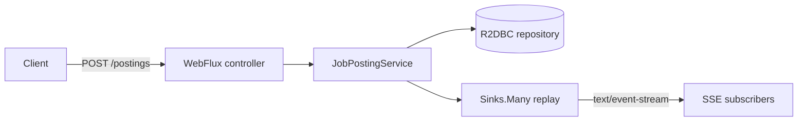

# Reactive Job Ingest Gateway

[](https://github.com/Deshraj-Jogiya/reactive-job-ingest-gateway/actions/workflows/ci.yml) 

A Spring WebFlux service that ingests job-posting events without blocking a thread per request, stores them through R2DBC, and republishes
them as a live Server-Sent Events stream.

## Highlights

- **Non-blocking ingestion:** a WebFlux REST endpoint persists incoming events via R2DBC.
- **Live SSE stream:** a replaying `Sinks.Many` republishes ingested postings, so a client that connects mid-stream first receives recent
  history, then live updates.
- **Verified by running it:** the packaged app was driven with curl, including an SSE subscriber receiving an event ingested after it
  connected. Two bugs that only showed up at runtime were found and fixed.

## Architecture



## Stack

Java, Spring Boot, Spring WebFlux, Project Reactor, R2DBC, JUnit, GitHub Actions.

## Run it

```bash
mvn spring-boot:run             # API on http://localhost:8080
mvn test
curl -X POST http://localhost:8080/api/postings -H "Content-Type: application/json" -d '{"companyName": "Acme", "jobTitle": "Data Engineer", "source": "manual"}'
curl -N http://localhost:8080/api/postings/stream   # live Server-Sent Events
```

It runs on an in-memory H2 database through R2DBC by default; `src/main/resources/application.yml` holds the port and connection URL.
